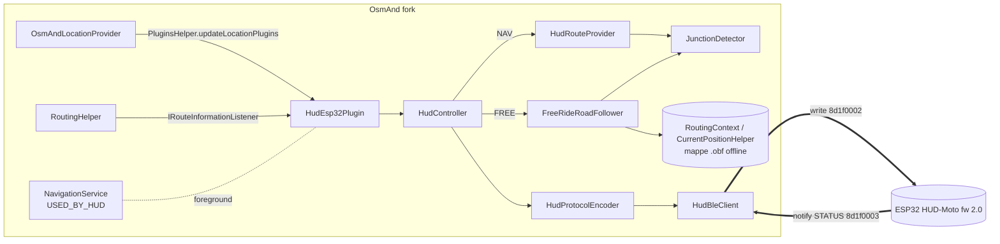
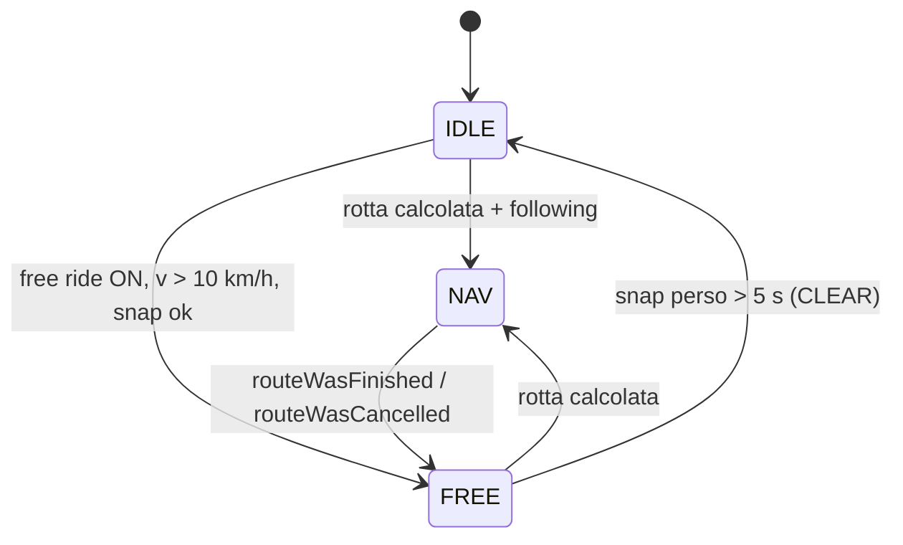

# SPEC v2 – HUD‑Moto senza Chronos: plugin OsmAnd "HUD ESP32" + firmware v2

> **Non eseguita.** Scritta l'11 ottobre 2026. Il firmware non è stato portato
> a questa v2 e il plugin OsmAnd non esiste. Il canale in uso è l'app
> `android/` (`it.diy.hudnav`) più il firmware 1.1.0, con Chronos ancora
> compilato e `ROUTE_BLE_ENABLE 1`. Lo stato da cui si riparte è
> `NOTE_PROGETTO.md`. Questo file resta una specifica, non un compito aperto.
> Il passo deciso il 20 novembre 2026 è pubblicare `Navigatore-moto` su GitHub
> e riprendere i tre difetti HUD del 7 ottobre (strade vicine, cavalcavia, rotonda).

> Documento **autosufficiente** per un agente Cursor che lavora su **due repository**:
> - **R1 – firmware** `hud-firmware/` (PlatformIO, ESP32 / XIAO ESP32‑C3, versione attuale `1.1.0` con Chronos)
> - **R2 – fork OsmAnd** (https://github.com/osmandapp/OsmAnd, branch `master`)
>
> Versione spec: **2.0** – 11/10/2026 – autore: Enrico Menegatti.
> Novità rispetto alla v1: **Chronos eliminato del tutto**. Il plugin OsmAnd fornisce *tutti* i dati per *tutte* le modalità (ICONA, MAPPA, CURVA, orologio). Tutti i riferimenti al codice OsmAnd sono **verificati** sul sorgente (commit `3bf10c23`, 11/10/2026): file + riga indicati in §12. Le righe sono indicative (cambiano con i commit): cercare per nome.
>
> Convenzioni: **DEVE** = obbligatorio, **DOVREBBE** = consigliato. Ogni task ha ID (`F*` firmware, `P*` plugin, `T*` strumenti) e criteri di accettazione (CA).

---

## 0. Riassunto operativo

1. **Firmware (R1):** togliere ChronosESP32 e il fallback Waze; server GATT NimBLE proprio (`HUD-Moto`); protocollo BLE **v2** (pacchetti v1 0x01–0x05 invariati + nuovi 0x10–0x18 + caratteristica STATUS); **doppio buffer** del percorso; avviso **incrocio (T) / rotonda (cerchio)** al posto del box grado in CURVA; ICONA/MAPPA guidate da pacchetti MANEUVER/TRIP con **glifi disegnati dal firmware**; orologio da TIME; timeout/dati vecchi; DEMO solo senza dati. **Rendering e gradi di CURVA identici.**
2. **Strumento (R1):** `tools/ble_sender.py` (Python + bleak) che riproduce GPX/demo + posizioni + manovre verso l'ESP32, per provare senza il plugin.
3. **Plugin (R2):** `HudEsp32Plugin` dentro OsmAnd, flavor installabile affiancato (`net.osmand.plus.hud`), BLE client, modalità NAV e GIRO LIBERO, incroci/rotonde, manovre, ora, background.
4. Ordine consigliato: F1→F7 + T1 (testabile al banco), poi P0→P9.

---

## 1. Contesto

- HUD moto DIY per **guida sportiva** (forma/gravità della prossima curva) + turn‑by‑turn.
- Forma 1: HUD monoculare nel casco **Shark Spartan** (vetrino 45°, immagine specchiata `MIRROR_X`). Forma 2: display al manubrio.
- HW attuale: **ESP32 (`esp32dev`) + OLED SSD1306 128×64** I2C (SDA 21/SCL 22). HW futuro: **XIAO ESP32‑C3 + OLED 0,49" 64×32** (SDA 6/SCL 7): protocollo e RAM devono restare leggeri.
- Modalità firmware (tasto BOOT breve: ICONA → MAPPA → CURVA, persistita in NVS; lungo: toggle MIRROR_X):
  - **ICONA** – simbolo manovra 48×48 + distanza + via + ETA/resto.
  - **MAPPA** – mini‑mappa heading‑up stile AR‑Track con colonne velocità/ora/ETA.
  - **CURVA** – solo strada davanti 150–300 m (auto‑zoom) + distanza inizio curva + grado 1–6 (+STRINGE/LUNGA). **Vincolo: identica.** Codice: `src/curve.cpp` (detector), `src/curve_view.cpp` (vista), `ui::drawCurveScreen` in `src/hud_ui.cpp`.
- Sicurezza: ritardo GPS ~1 s (~20 m a 70 km/h). Ausilio indicativo, non per decidere la frenata.

---

## 2. Stato attuale del firmware (R1, v1.1.0) – da conoscere prima di modificare

| File | Contenuto |
|---|---|
| `platformio.ini` | env `esp32dev`, `xiao_esp32c3`; `lib_deps`: `fbiego/ChronosESP32@^1.9.1` (porta con sé **NimBLE‑Arduino 2.5.1** e ESP32Time), Adafruit SSD1306/GFX |
| `include/config.h` | pin, OLED, `MIRROR_X/Y`, `NAV_LAYOUT_DEFAULT`, `FRAME_MS 120`, `NAV_STALE_MS`, `MAP_METERS_PER_PX 3`, `DEMO_MODE`, `CURVE_DEMO_IF_NO_ROUTE 1`, `ROUTE_BLE_ENABLE 0`, `WAZE_NOTIFICATION_FALLBACK 1` |
| `src/main.cpp` | `ChronosESP32 watch(HUD_BLE_NAME)`; callback Chronos (connessione, nav, icona 3×96 byte con CRC); fallback Waze da notifiche; servizio route aggiunto al server NimBLE di Chronos (`setupRouteBle`, coda FreeRTOS 24 pacchetti, `RoutePacket{u16 len; u8 data[244]}`); `render()` = splash → (CURVA sempre) → attesa → nav → idle (`drawIdle(..., "Chronos OK", hint, batteria telefono)`) |
| `src/route_rx.h/.cpp` | `curve::RouteReceiver` – parser pacchetti 0x01–0x05 + encoder (`encodeBegin/Points/End/Pos`) |
| `src/curve.h/.cpp` | `curve::Route` (ricampionamento 5 m, `MAX_PTS 2400` = 12 km, curvatura 3 punti, curve, gradi), `GeoOrigin`, `project(p, hint)` |
| `src/curve_view.h/.cpp` | `buildView(route, s, CurveView&, zoom*)`, `buildMountainRoad` (demo), `DemoRider` |
| `src/hud_ui.h/.cpp` | `NavView` (stringhe + **`icon[288]` bitmap Chronos**), `CurveView`, `drawSplash/Waiting/Idle/NavIcon/NavMap/MiniMap/CurveScreen`, `drawFallbackArrow`; `drawWaiting` scrive "Apri app Chronos" |
| `src/demo_data.*` | percorso mini‑mappa demo, `makeTurnRightIcon` (bitmap), `fillNav` |
| `tools/render_previews.py` | compila sul PC gli stessi sorgenti (shim in `tools/host_shim`) → `preview_*.png` + `preview_curve_demo.gif`, poi esegue `tools/test_curves.cpp` |
| `tools/test_curves.cpp` | test detector, proiezione, formato BLE (208 punti/9 pacchetti → 9 curve), vista CURVA |

### 2.1 Protocollo v1 esistente (resta valido, byte‑identico)
GATT: servizio `8d1f0001-6a4c-4b3e-9a0e-7c2d5f1e4b00`, caratteristica RX `8d1f0002-6a4c-4b3e-9a0e-7c2d5f1e4b00` (WRITE | WRITE_NR). Ogni scrittura = 1 pacchetto. Little‑endian. lat/lon `int32` = gradi×1e7 arrotondati (`deg*1e7 ± 0.5`).

| Tipo | Nome | Layout | Len | Effetto |
|---|---|---|---|---|
| 0x01 | BEGIN | `u8, u16 nPunti, i32 lat0, i32 lon0` | 11 | azzera, (lat0,lon0) = origine piano locale **e primo punto**; `nPunti` oggi ignorato |
| 0x02 | POINTS | `u8, u16 indicePrimo, u8 n, n×(i32 lat, i32 lon)` | 4+8n | `indicePrimo` = punti già ricevuti, altrimenti `ErrSequence`; max 30 punti con MTU 247 |
| 0x03 | END | `u8, u16 nPunti` | 3 | se conteggio torna: `finish()` → `RouteReady`, altrimenti `ErrCount` |
| 0x04 | POS | `u8, i32 lat, i32 lon, u16 vel 0,1 km/h, u16 rotta 0,1°` | 13 | posizione pilota |
| 0x05 | CLEAR | `u8` | 1 | cancella percorso |

Esempi (verificati con script): origine 45.4642035, 9.1899820:
```
BEGIN : 01 02 00 73 49 19 1B AC 47 7A 05
END   : 03 02 00
POS   : 04 73 49 19 1B AC 47 7A 05 2C 01 84 03   (30,0 km/h, rotta 90,0°)
CLEAR : 05
```
Comportamenti attuali: durante il caricamento CURVA mostra "CARICO PERCORSO" (BEGIN azzera subito la rotta visibile → **flash a ogni aggiornamento**, da eliminare in F3); con rotta e senza POS "ATTESA GPS"; DEMO sparisce al primo pacchetto valido.

---

## 3. Protocollo BLE v2 (contratto tra R1 e R2)

### 3.1 GATT
| Elemento | UUID | Proprietà | Direzione |
|---|---|---|---|
| Servizio HUD | `8d1f0001-6a4c-4b3e-9a0e-7c2d5f1e4b00` | – | – |
| RX | `8d1f0002-6a4c-4b3e-9a0e-7c2d5f1e4b00` | WRITE, WRITE_NR | telefono → HUD |
| **STATUS** (nuova) | `8d1f0003-6a4c-4b3e-9a0e-7c2d5f1e4b00` | READ, NOTIFY | HUD → telefono |

Advertising: nome `HUD-Moto` + UUID servizio nello scan response. MTU preferito 247. Nessun bonding/cifratura.

### 3.2 Regole generali
- Pacchetti 0x01–0x05 **invariati**. Nuovi tipi 0x10–0x18. Tipo sconosciuto → `ErrType`, ignorato (compatibilità in avanti).
- Interi little‑endian; distanze `u16` in metri saturate a 65535; angoli in 0,1°; testo UTF‑8 (il firmware lo converte con `ui::utf8ToAscii`).
- Nessun pacchetto > MTU−3. Con MTU < 247 il mittente usa `n = (mtu-3-4)/8` punti per POINTS.
- Stato idempotente: per POS/MANEUVER/JUNCTION/TRIP/TIME vale l'ultimo ricevuto. Ack solo per le rotte via STATUS.
- Sequenza rotta: `ROUTE_META → BEGIN → POINTS… → END`. Si possono interporre POS/MANEUVER/JUNCTION tra i POINTS.

### 3.3 Tabella pacchetti v2 (nuovi)
| Tipo | Nome | Layout | Len | Note |
|---|---|---|---|---|
| 0x10 | HELLO | `u8, u8 protoVer(=2), u8 caps, u8 0` | 4 | caps bit0 MANEUVER, bit1 JUNCTION, bit2 POS2, bit3 TRIP, bit4 TIME. Inviato a ogni connessione. |
| 0x11 | ROUTE_META | `u8, u16 routeId, u8 source, u8 flags, u16 backM, u16 totalM` | 9 | source 0=NAV,1=FREE,2=TEST; flags bit0=ricalcolo, bit1=finestra successiva. Vale per la prossima BEGIN…END. |
| 0x12 | POINTS_DELTA | `u8, u16 indicePrimo, u8 n, n×(i16 dEst_dm, i16 dNord_dm)` | 4+4n | facoltativo; delta in decimetri dal punto precedente (BEGIN = (0,0)); fino a 60 punti/pacchetto. Mescolabile con POINTS nella stessa rotta. |
| 0x13 | JUNCTION | `u8, u8 kind, u16 distM, u8 side, u8 exit, u16 routeId, u16 sJunction` | 10 | kind 0=nessuno,1=incrocio,2=rotonda,3=fine strada; side 0=n.d.,1=sx,2=dx,3=entrambi; `sJunction` = metri dall'inizio della rotta `routeId` (0xFFFF = n.d.) |
| 0x14 | MANEUVER | `u8, u8 turn, u16 distM, u8 exit, u8 flags, u8 len, len×UTF‑8` | 7+len | len ≤ 64; turn = codici §3.5; flags bit0=arrivo imminente, bit1=fuori rotta |
| 0x15 | POS2 | `u8, i32 lat, i32 lon, u16 vel, u16 rotta, u8 accM, u8 flags, u16 routeId, u16 sOnRoute` | 19 | flags bit0 snappata, bit1 simulata, bit2 galleria/dead‑reckoning; `sOnRoute` metri dall'inizio di `routeId` (0xFFFF n.d.) |
| 0x16 | HEARTBEAT | `u8, u8 state` | 2 | state 0=IDLE,1=NAV,2=FREE; ogni 2 s se non si invia altro |
| 0x17 | TIME | `u8, u32 unixUTC, i16 offsetMin` | 7 | ora per l'orologio (offset fuso incl. ora legale, es. +120) |
| 0x18 | TRIP | `u8, u32 restoM, u32 restoS, u16 etaMinGiorno, u8 flags` | 12 | ETA in minuti dalla mezzanotte locale (0xFFFF n.d.); flags bit0=arrivato |

**STATUS (8 byte):** `u8 protoVer(=2), u8 fwMajor, u8 fwMinor, u8 fwPatch, u16 lastRouteId, u8 lastResult, u8 freeQueue`. `lastResult` = enum `RxResult` (sotto). Notify dopo END (riuscito o no), dopo HELLO e su errore.

`RxResult` (firmware): `0 Ok, 1 RouteReady, 2 Position, 3 Cleared, 4 Hello, 5 Meta, 6 Junction, 7 Maneuver, 8 Heartbeat, 9 Time, 10 Trip, 11 ErrShort, 12 ErrType, 13 ErrSequence, 14 ErrCount, 15 ErrNoBegin`.

Esempi v2 (da rigenerare nei test, CA F2):
```
HELLO      : 10 02 1F 00
ROUTE_META : 11 2A 00 00 00 64 00 DC 05            routeId 42, NAV, back 100 m, tot 1500 m
JUNCTION   : 13 02 50 00 00 02 2A 00 40 02         rotonda a 80 m, 2a uscita, rotta 42, s=576
MANEUVER   : 14 03 2C 01 00 00 08 56 69 61 20 52 6F 6D 61   sinistra, 300 m, "Via Roma"
HEARTBEAT  : 16 01
TIME       : 17 <u32 unix> 78 00                    offset +120 min
```

### 3.4 Ritrasmissione
Il mittente attende STATUS dopo END (timeout 1 s). Se `lastRouteId != routeId` o `lastResult != 1` → ritrasmette la rotta (max 2 volte), poi passa alla successiva.

### 3.5 Codici manovra e glifi firmware
Il firmware disegna i glifi (nessuna bitmap via BLE). Mappatura da `net.osmand.router.TurnType` (costanti verificate, `TurnType.java` righe 11–24):

| `turn` | Significato | OsmAnd `TurnType` | Glifo firmware 48×48 |
|---|---|---|---|
| 0 | nessuna | – | freccia dritta di riserva (`drawFallbackArrow`) |
| 1 | dritto | `C` (1) | asta dal basso + freccia in alto |
| 2 | leggera sx | `TSLL` (3) | asta + braccio a −45° |
| 3 | sx | `TL` (2) | braccio a −90° |
| 4 | stretta sx | `TSHL` (4) | braccio a −135° |
| 5 | leggera dx | `TSLR` (6) | +45° |
| 6 | dx | `TR` (5) | +90° |
| 7 | stretta dx | `TSHR` (7) | +135° |
| 8 | inversione a sx | `TU` (10) | asta, semicerchio verso sx, freccia in giù |
| 9 | inversione a dx | `TRU` (11) | speculare |
| 10 | tieni sx | `KL` (8) | biforcazione: ramo sx spesso con freccia, ramo dx sottile |
| 11 | tieni dx | `KR` (9) | speculare |
| 12 | rotonda (antioraria, guida a destra) | `RNDB` (13) + `getExitOut()` | anello (raggio 10–13 px) + ingresso dal basso + braccio d'uscita (1ª=dx 90°, 2ª=dritto, 3ª=sx, ≥4=indietro‑sx 135°) + **numero uscita** al centro (font 2×) |
| 13 | rotonda oraria | `RNLB` (14) | come 12 ma angoli speculari |
| 20 | arrivo | ultima direzione della rotta / `routeWasFinished` | segnaposto (cerchio pieno con foro + punta) |
| 21 | fuori rotta | `OFFR` (12) | "?" grande |

Implementazione suggerita: `ui::drawManeuver(GFXcanvas1&, x, y, turn, exitNum)` con primitive esistenti `thickLine` (r=3 → tratto 7 px), `fillTriangle` per la punta (lunghezza 11, semilarghezza 8), `drawCircle` per l'anello. Per il futuro OLED 64×32 la stessa funzione DEVE accettare un fattore di scala (`size` 24 o 48) – non obbligatorio in v2.

---

## 4. Task FIRMWARE (R1)

Prima di iniziare: `git tag v1.1-chronos` sullo stato attuale **oppure** copia in `old_chronos/` (sorgenti, `platformio.ini`, README, tools). Versione nuova: `HUD_FW_VERSION "2.0.0"` (+ `HUD_FW_MAJOR/MINOR/PATCH` per STATUS).

### F1 – Rimozione Chronos e server GATT proprio
- `platformio.ini`: togliere `fbiego/ChronosESP32`; aggiungere `h2zero/NimBLE-Arduino@^2.5.1` (API 2.x: `onWrite(NimBLECharacteristic*, NimBLEConnInfo&)`, `onConnect(NimBLEServer*, NimBLEConnInfo&)`, `onDisconnect(NimBLEServer*, NimBLEConnInfo&, int reason)` – già usate nel codice attuale).
- `config.h`: rimuovere `ROUTE_BLE_ENABLE` (servizio sempre attivo) e `WAZE_NOTIFICATION_FALLBACK`; aggiornare commenti "Chronos"; aggiungere:
  `BLE_MTU 247`, `DATA_STALE_MS 5000`, `DATA_TIMEOUT_MS 30000`, `POS_TIMEOUT_MS 10000`, `MANEUVER_TIMEOUT_MS 10000`, `JUNCTION_TIMEOUT_MS 5000`, `JUNCTION_SHOW_M 300`.
- `main.cpp`: eliminare `ChronosESP32 watch`, `pullNavigation`, `pullIcon`, `onConfig`, `onNotification`, `pullWaze`, `findDistance`, uso di `watch.*` (ora, batteria telefono). Nuovo `setupBle()`: `NimBLEDevice::init(HUD_BLE_NAME)`, `setMTU(BLE_MTU)`, server con callback connessione (flag volatili), servizio con RX + STATUS, advertising con nome e UUID, riavvio advertising alla disconnessione. Callback RX → coda FreeRTOS (come oggi); il parsing resta nel `loop()`.
- **CA:** `pio run` OK su entrambi gli env; nessun simbolo/include Chronos (`rg -i chronos src include platformio.ini` vuoto, a parte commenti storici nel README); il telefono vede `HUD-Moto` con servizio `8d1f0001-…` e 2 caratteristiche (verifica con nRF Connect).

### F2 – Parser/encoder protocollo v2 (`src/route_rx.*`)
- Estendere `RouteReceiver` con i tipi §3.3 e lo stato associato: `peerProto/caps`, `routeId` della rotta attiva e `source`, `state`, `Junction`, `Maneuver` (nome fino a 64 byte + terminatore), `Trip`, `unixTime/tzOffsetMin`, campi POS2 (`accuracy`, `flags`, `sOnRoute` – ignorato se `routeId` diverso), `lastResult`.
- `POINTS_DELTA`: accumula i delta in metri locali partendo dall'origine BEGIN (`Route::addPoint(Vec2)`); dopo un POINTS assoluto il punto corrente è `origin().toLocal(lat,lon)`.
- `buildStatus(out, fwMaj, fwMin, fwPatch, freeQueue)` → 8 byte.
- Encoder statici per **tutti** i tipi (`encodeHello/Meta/PointsDelta/Junction/Maneuver/Pos2/Heartbeat/Time/Trip/Clear` + esistenti invariati).
- Codice **portabile** (nessun Arduino): compilato anche sul PC.
- **CA:** test host (F8) verdi; i byte degli esempi §2.1/§3.3 coincidono.

### F3 – Doppio buffer del percorso
- Due `curve::Route` statiche (≈34 KB l'una: `pts_` 2400×8 + `kappa_` 2400×4 + curve; verificare con `sizeof`). `RouteReceiver(Route &a, Route *b = nullptr)`: con `b` il BEGIN carica nel buffer di riserva, l'END corretto **scambia i puntatori**; con `b == nullptr` comportamento v1 (per i test esistenti). `route()` restituisce l'attivo; `routeVersion()` incrementa a ogni scambio/CLEAR (il `loop` azzera `curveHint`; `curveZoom` resta per non far saltare lo zoom).
- Errori (`ErrSequence`, `ErrCount`) **non** toccano la rotta attiva.
- "CARICO PERCORSO" solo se si sta caricando **e** non c'è una rotta attiva pronta.
- Demo: la strada demo si costruisce nel buffer attivo (`buildMountainRoad(routeRx.route())`); una rotta reale la sostituisce con lo scambio. Nessun terzo buffer.
- Se la RAM del C3 non basta: `MAX_PTS` configurabile (es. 1200 = 6 km) con `#ifdef HUD_BOARD_XIAO_C3`.
- **CA:** test host: rotta A attiva, caricamento di B a metà → `route()` è ancora A (stesse curve); dopo END → B; END con conteggio errato → A intatta. Al banco con T1: nessun "CARICO PERCORSO" durante i refresh della finestra.

### F4 – Avviso incrocio/rotonda in CURVA
- `CurveView` + campi `uint8_t junctionKind; int32_t junctionDist; bool stale;` (il chiamante li imposta; `buildView` non li tocca).
- Calcolo nel `loop`: JUNCTION valido se ricevuto da < `JUNCTION_TIMEOUT_MS` e `kind != 0`. Se `sJunction != 0xFFFF`, `junction.routeId == routeId attivo` e c'è posizione proiettata `s` → `dist = sJunction − s` (se < 0: nessun avviso); altrimenti `dist = distM`.
- In `ui::drawCurveScreen`: `junc = kind && dist ≥ 0 && dist ≤ JUNCTION_SHOW_M && (grade == 0 || distance < 0 || dist < distance)`. Se `junc`: la distanza grande mostra `dist`; al posto del box grado un riquadro bianco arrotondato 29×29 (stessa posizione `by = 27`, stesso lato `left`) con dentro in nero: **"T"** (barra 21×5 + gamba 5×20) per kind 1 e 3; **cerchio** (anello raggio 7–10) per kind 2. STRINGE/LUNGA nascosti mentre è visibile l'avviso.
- Se `junc == false` il disegno DEVE essere **pixel‑identico** alla v1 (stesso codice, stessi numeri).
- `stale`: quadratino lampeggiante 4×4 in alto a destra (stesso `drawStale` di ICONA/MAPPA) se nessun pacchetto da `DATA_STALE_MS` e la rotta non è demo.
- **CA:** anteprime `preview_curve_junction_t_120m.png` (incrocio a 120 m prima di una curva più lontana) e `preview_curve_roundabout_80m.png` (rotonda a 80 m); le 3 anteprime CURVA esistenti e la GIF **byte‑identiche** a quelle v1 (confronto `cmp` con i PNG del tag `v1.1-chronos`).

### F5 – ICONA e MAPPA guidate da MANEUVER/TRIP
- `NavView`: rimuovere `hasIcon` e `icon[288]`; aggiungere `uint8_t maneuver; uint8_t exitNum;`. `drawIconOrFallback` → `ui::drawManeuver` (§3.5). `demo::fillNav(v, dist, via, withMap, turn = 6, exit = 0)`; eliminare `makeTurnRightIcon`.
- Riempimento `NavView` nel `loop` da MANEUVER/TRIP/POS/TIME:
  - `distance`: < 100 m → "%d m" (passo 5 m); < 1000 m → passo 10 m; ≥ 1 km → "%d,%d km".
  - `street`: nome UTF‑8 → ASCII.
  - `eta` "HH:MM" da `etaMinGiorno`; `remaining` "12 km"/"850 m"; `duration` "18 min"/"1h20".
  - `speed` dalla POS se più recente di `POS_TIMEOUT_MS`.
  - `clock` dall'orologio TIME (F6).
- **MAPPA con geometria reale:** se c'è rotta attiva + posizione, costruire fino a 64 `MapPoint` heading‑up da `s−30` a `s+250` m (passo 5 m) lungo la rotta: direzione `f = norm(at(s+5) − at(s))`, destra `r = (f.y, −f.x)`, `x = d·r`, `y = d·f`; `metersPerPx = MAP_METERS_PER_PX`. Niente laterali (`branchCount = 0`). Senza geometria: fallback glifo al centro (come oggi con l'icona).
- Navigazione attiva = MANEUVER ricevuto da < `MANEUVER_TIMEOUT_MS` con `turn != 0`, oppure HEARTBEAT state = NAV.
- **CA:** anteprime `preview_nav_icon_roundabout_exit2.png` (turn 12, uscita 2), `preview_nav_icon_left.png` (turn 3), `preview_nav_map.png` rigenerata con glifo; anteprima con tutti i glifi `preview_glyphs.png` (griglia o file separati `preview_glyph_<code>.png`).

### F6 – Orologio, schermate di stato, timeout
- TIME: salvare `baseUnix`, `baseMillis`, `tzMin`; ora locale = `baseUnix + (millis−baseMillis)/1000 + tzMin*60` → `gmtime_r` → "HH:MM" e "Dom 11 ott". Valida se `baseUnix ≥ 1704067200` (2024).
- `render()`:
  1. splash per `SPLASH_MS`;
  2. CURVA sempre disponibile (come oggi);
  3. non connesso → `drawWaiting` con testo **"Apri OsmAnd HUD"**;
  4. navigazione attiva → ICONA/MAPPA;
  5. altrimenti `drawIdle(clock, date, status, hint, -1)` con status "OsmAnd OK" (o "Giro libero" se state = FREE), hint "Avvia navigazione" / "Giro libero: vedi CURVA"; nessuna batteria telefono (`-1`).
- Timeout: nessun pacchetto da `DATA_TIMEOUT_MS` → manovra/junction/trip azzerati; CURVA: se `CURVE_DEMO_IF_NO_ROUTE` ricostruisce la demo nel buffer attivo e torna "DEMO", altrimenti "NESSUN PERCORSO". POS più vecchia di `POS_TIMEOUT_MS` con rotta reale → "ATTESA GPS". Alla disconnessione: stato navigazione azzerato subito, rotta tenuta fino al timeout (riconnessioni brevi non fanno perdere la rotta).
- **DEMO solo senza dati:** DEMO visibile solo se non è mai arrivata una rotta reale o dopo il timeout.
- STATUS: notify dopo END, HELLO, errori; READ sempre aggiornato.
- `DEMO_MODE 1` continua a funzionare (schermate finte, ora "10:24").
- **CA:** anteprime `preview_idle.png` (status "OsmAnd OK") e `preview_waiting.png` rigenerate; test manuale con T1: spegnendo il sender, dopo 5 s quadratino "dato vecchio", dopo 30 s ritorno a DEMO/orologio.

### F7 – Build
- `pio run -e esp32dev` e `pio run -e xiao_esp32c3` senza errori né warning nuovi; riportare **Flash e RAM** di entrambi (output `RAM: … Flash: …`). Atteso: RAM in aumento di circa 35 KB per il secondo buffer, Flash in calo (niente Chronos/ESP32Time).
- **CA:** entrambe le build OK, RAM statica < 70 % su C3.

### F8 – Test host e anteprime
- `tools/test_curves.cpp`: aggiornare (costruttore a buffer singolo invariato) e aggiungere **`tools/test_protocol.cpp`** (o una sezione) con:
  - round‑trip di ogni encoder/parser (tutti i tipi, campi limite: lat/lon negativi, 0xFFFF, nome di 64 e 65 byte → troncato, len oltre buffer → `ErrShort`);
  - POINTS_DELTA = POINTS (stesse curve, scarto < 0,2 m);
  - doppio buffer (CA F3); sequenza errata; tipo sconosciuto → `ErrType` senza effetti;
  - `buildStatus`;
  - vettori hex §2.1/§3.3 stampati e confrontati.
- `tools/render_previews.py`: compilare anche `route_rx.cpp`, eseguire entrambi i test, generare le nuove anteprime: `preview_curve_junction_t_120m.png`, `preview_curve_roundabout_80m.png`, `preview_nav_icon_roundabout_exit2.png`, `preview_nav_icon_left.png`, `preview_glyphs.png` (+ rigenerare tutte le esistenti).
- **CA:** "TUTTI I TEST OK", anteprime prodotte, anteprime CURVA senza incrocio identiche alla v1.

### F9 – Documentazione
- README: sezione "Protocollo BLE v2" (tabella §3), rimozione istruzioni Chronos/Waze, uso di `ble_sender.py`, nuove anteprime, valori Flash/RAM.
- `NOTE_PROGETTO.md`: stato "senza Chronos", prossimi passi.

---

## 5. Task STRUMENTO (R1) – T1 `tools/ble_sender.py`

Script Python 3.10+ con **bleak** (`pip install bleak gpxpy`), per provare il firmware senza il plugin (PC Linux/Windows/macOS con Bluetooth LE).

- CLI:
  ```
  python tools/ble_sender.py [--name HUD-Moto | --address AA:BB:..] [--gpx file.gpx | --demo]
                             [--speed 60] [--rate 2] [--window 1500] [--free] [--loop]
                             [--junction-every 400] [--maneuvers] [--hex-dump]
  ```
- Funzioni:
  1. scansione per nome o UUID servizio, connessione, `HELLO`, `TIME` (ora del PC + offset fuso), sottoscrizione a STATUS (stampa decodificata);
  2. carica la traccia (GPX `trk`/`rte`, oppure `--demo` = strada sintetica con tornanti, rotonda e incrocio);
  3. simula il pilota a `--speed` km/h lungo la traccia, invia `POS2` a `--rate` Hz;
  4. finestra scorrevole (`ROUTE_META` + BEGIN/POINTS/END) ogni volta che restano < 600 m; con `--free` source = FREE e finestra che si ferma al prossimo incrocio simulato (max 500 m);
  5. `JUNCTION` sintetici ogni `--junction-every` m (alternando incrocio/rotonda) con distanza aggiornata a ogni POS;
  6. con `--maneuvers`: `MANEUVER` calcolati dalla geometria (svolte > 30° ai punti di incrocio simulati, nome via fittizio o `name` del GPX) + `TRIP` (resto, ETA);
  7. `HEARTBEAT` ogni 2 s; ritrasmissione rotta se STATUS non conferma (§3.4);
  8. `--hex-dump`: stampa ogni pacchetto in esadecimale (per confronto con i test C++ e Java).
- Encoder in un modulo separato `tools/hudproto.py` (riusabile e testabile: `python -m pytest tools/test_hudproto.py` confronta i vettori hex di §2.1/§3.3 e quelli stampati dal test C++).
- **CA:** con un ESP32 flashato v2: CURVA segue la traccia senza flash, incroci/rotonde appaiono, ICONA/MAPPA mostrano glifi, distanza, via, ETA; orologio corretto; interrompendo lo script scattano i timeout F6.

---

## 6. Requisiti funzionali del PLUGIN (R2)

### RF‑A Navigazione (OsmAnd naviga)
- **A1** Se `RoutingHelper.isRouteCalculated()` e `isFollowingMode()`: geometria in **finestra scorrevole** `[sRider−100, sRider+ahead]` (ahead 1500 m, 500–3000).
- **A2** Nuova finestra quando: restano < 600 m; `newRouteIsCalculated` (ricalcolo); deviazione > 50 m per > 3 s; riconnessione.
- **A3** `POS2` a 1–5 Hz (default 2; 5 sopra 60 km/h), con `sOnRoute`; posizione da `RoutingHelper.getLastFixedLocation()` (snappata) se disponibile.
- **A4** `MANEUVER` a ogni cambio e almeno ogni 1 s: da `RoutingHelper.getNextRouteDirectionInfo(new NextDirectionInfo(), false)` → `directionInfo.getTurnType()` (mappa §3.5, `getExitOut()` per le rotonde), `distanceTo`, nome via da `RouteDirectionInfo.getStreetName()`/`getRef()`/`getDestinationName()` (in ordine di disponibilità).
- **A5** `TRIP` ogni 5 s: `RoutingHelper.getLeftDistance()`, `getLeftTime()`; ETA = ora locale + leftTime.
- **A6** `JUNCTION` (vedi RF‑C) anche in navigazione: la geometria segue il percorso, gli incroci si segnalano soltanto.
- **A7** Fine/annullamento (`routeWasFinished` → MANEUVER `turn=20` per 10 s; `routeWasCancelled`) → GIRO LIBERO se abilitato, altrimenti CLEAR.

### RF‑B Giro libero
- **B1** Map matching della posizione sulla strada corrente (§8.3), **B2** seguire la strada in avanti fino al prossimo incrocio rilevante o max 500 m (200–1000), **B3** inviare con `source=FREE`, ricostruire quando restano < 150 m, cambio strada o incrocio superato, **B4** snap inaffidabile (> 25 m, heading > 45°, accuracy > 30 m) → nessun invio; dopo 5 s CLEAR.
- **B5** Nessun MANEUVER in giro libero (ICONA/MAPPA mostrano l'orologio, HEARTBEAT state=FREE).

### RF‑C Incroci/rotonde
- Incrocio rilevante = nodo con almeno un'altra strada di classe **pari o superiore** (gerarchia §8.5), esclusi `service`, `track`, `path`, `footway`, `cycleway`, `steps`, `bridleway`, `pedestrian`, `living_street`, accessi privati, `*_link` opzionale. Rotonda = `RouteDataObject.roundabout()` (giro libero) o `TurnType.isRoundAbout()` (navigazione). Distanza lungo la geometria, aggiornata a ogni POS2. Soglie configurabili.

### RF‑D Background, BLE, impostazioni
- **D1** Schermo spento: in navigazione basta il `NavigationService` di OsmAnd; in giro libero il plugin lo avvia con un proprio flag d'uso (§8.6, P8).
- **D2** Scansione filtrata per UUID `8d1f0001-…` (e nome `HUD-Moto`), MAC salvato, riconnessione con backoff 1/2/5/10 s poi ogni 15 s, `autoConnect` dopo la prima connessione.
- **D3** Su connessione: `requestMtu(247)`, `setPreferredPhy(2M)` se disponibile, abilitazione notify STATUS, `HELLO`, `TIME`, poi stato corrente (rotta, manovra, trip, posizione).
- **D4** Impostazioni (preferenze plugin, §P2):

| Chiave | Tipo | Default |
|---|---|---|
| `hud_esp32_device_address` / `_name` | String | null |
| `hud_esp32_pos_rate_hz` | Integer 1–5 | 2 |
| `hud_esp32_window_ahead_m` | Integer | 1500 |
| `hud_esp32_free_ride` | Boolean | true |
| `hud_esp32_free_ride_max_m` | Integer | 500 |
| `hud_esp32_junction_min_class` | String (`same_or_higher`/`any_public`/`higher_only`) | same_or_higher |
| `hud_esp32_junction_ignore_links` | Boolean | true |
| `hud_esp32_junction_search_m` | Integer | 500 |
| `hud_esp32_debug_log` | Boolean | false |

- **D5** Pulsante "Test HUD" (rotta sintetica + manovre per 20 s). **D6** Stato visibile (disconnesso/connessione/connesso NAV|FREE|IDLE, ultimo `STATUS`).

### RF‑E Chronos
Non più usato. Il plugin è l'unico client. Da documentare per l'utente: disinstallare/disabilitare Chronos per non avere due app connesse.

---

## 7. Requisiti non funzionali (plugin)
- **Batteria:** < 3 %/h oltre a OsmAnd in navigazione; nessun wake lock proprio; ricerche strade ≤ 1 Hz e solo con spostamento > 10 m.
- **Latenza:** `updateLocation` → scrittura POS2 < 300 ms (obiettivo < 100 ms).
- **Banda:** MTU 247, 2M PHY, POS2 con `WRITE_NO_RESPONSE`, una scrittura GATT in volo, coalescenza della POS.
- **Robustezza:** nessun crash di OsmAnd per errori BLE/permessi; try/catch su ogni callback.
- **Privacy:** dati solo verso l'HUD; log di debug locali e disattivati di default.
- **Licenza:** GPLv3 (`LICENSE` del repo); uso personale; se distribuito, pubblicare il sorgente e non usare i marchi.
- **Manutenibilità:** codice nel package `net.osmand.plus.plugins.hud`, modifiche al core limitate a: `PluginsHelper.initPlugins()` (1 riga), `NavigationService` (flag d'uso + tipo di notifica), `SettingsScreenType` (1 voce), `OsmAnd/build.gradle` (flavor), manifest del flavor, stringhe/icone.

---

## 8. Architettura e algoritmi del plugin

### 8.1 Classi (`OsmAnd/src/net/osmand/plus/plugins/hud/`)
| Classe | Ruolo |
|---|---|
| `HudEsp32Plugin extends OsmandPlugin` | `getId()` = `"osmand.hud.esp32"`, `getName()`, `getDescription(boolean)`, `init(app, activity)`, `disable(app)`, `updateLocation(Location)` (chiamato per ogni plugin abilitato da `PluginsHelper.updateLocationPlugins`), `getSettingsScreenType()` → `SettingsScreenType.HUD_ESP32_SETTINGS`, preferenze con `registerBooleanPreference/registerIntPreference/registerStringPreference`; registra un `IRouteInformationListener` con `app.getRoutingHelper().addListener(...)` |
| `HudSettingsFragment` | schermata impostazioni (scelta dispositivo, test, stato) + `res/xml/hud_esp32_settings.xml` |
| `HudBleClient` | scansione, connessione, MTU/PHY, coda scritture, riconnessione, notify STATUS; modellato su `plugins/externalsensors/devices/ble/BLEAbstractDevice.java` |
| `HudProtocolEncoder` | Java puro (testabile su JVM), byte‑identico a `route_rx.cpp` e `tools/hudproto.py` |
| `HudController` | macchina a stati IDLE/NAV/FREE, scheduler, costruzione pacchetti |
| `HudRouteProvider` | NAV: finestra, manovre (`TurnTypeMapper`), trip, incroci sul percorso |
| `FreeRideRoadFollower` | FREE: map matching + following |
| `JunctionDetector` | classificazione nodi/gerarchia/rotonde, su un'interfaccia `RoadGraphView` (finta nei test) |
| `TurnTypeMapper` | `TurnType` → codice §3.5 |
| `PolylineUtils` | Douglas‑Peucker, densificazione, cumulate, proiezione |





**Threading:** callback location/routing → solo copia e `post` su un `HandlerThread` "HudWorker"; calcoli ed encoder sul worker; callback GATT ripostate sul worker; una scrittura in volo; la POS più recente sostituisce quella in coda.

### 8.2 Finestra (NAV)
`RouteCalculationResult rc = routingHelper.getRoute()`; punti `rc.getImmutableAllLocations()` (o `getRouteLocations()`), indice corrente `rc.getCurrentRoute()`. **`getImmediateLocations()` / `getLocations()` non esistono.** Cumulate calcolate una volta per rotta (cache azzerata su `newRouteIsCalculated`). Semplificazione Douglas‑Peucker 1,5 m (0,5 m in curve con R < 60 m), passo max 25 m. `routeId` = contatore u16.

### 8.3 Map matching (FREE)
- Strada sotto la posizione: `app.getLocationProvider().getLastKnownRouteSegment()` → `CurrentPositionHelper.getLastKnownRouteSegment(Location)` (cache: nuova ricerca se > 15 m; restituisce `null` con accuracy > 50 m; usa `GeocodingLookupService.findRoads(loc, RoadsLookup.CURRENT_POSITION, ...)`). Ricerca asincrona: `CurrentPositionHelper.getRouteSegment(loc, appMode, cancelPrevious, ResultMatcher<RouteDataObject>)`.
- Topologia (strade collegate ai nodi): costruire un `RoutingContext` con `new RoutePlannerFrontEnd().buildRoutingContext(config, nativeLib, BinaryMapIndexReader[] files, RouteCalculationMode.NORMAL)` (come fa `RouteProvider`), poi `ctx.loadRouteSegment(x31, y31, memoryLimit)` → `BinaryRoutePlanner.RouteSegment` (lista collegata con `getNext()`, `getRoad()`, `getSegmentStart()`/`getSegmentEnd()`): sono tutte le strade che passano per quel punto 31‑bit. Coordinate: `MapUtils.get31TileNumberX/Y(lon/lat)`.
- Punteggio candidato: `d_perp/10 m + |Δheading|/30°` (heading solo se v > 2 m/s; considerare `getOneway()`); isteresi: cambio solo dopo 3 fix migliori o > 25 m.

### 8.4 Following ai nodi
Dal punto proiettato si avanza sui punti del `RouteDataObject` (`getPointsLength()`, `getPoint31XTile(i)`, `getPoint31YTile(i)`) nella direzione di marcia. A ogni nodo: segmenti uscenti da `loadRouteSegment` → filtrare i non rilevanti → 1 continuazione: proseguire; più continuazioni rilevanti: **incrocio** (stop, JUNCTION kind 1), eccetto continuazione con stesso `getName()`/`getRef(...)`, deviazione < 30° e altre di classe inferiore; nodo con `roundabout()` → stop, kind 2; fine dati/`max_m` → stop (kind 3 se vicolo cieco).

### 8.5 Gerarchia `highway` (da `RouteDataObject.getHighway()`)
`motorway 0 > trunk 1 > primary 2 > secondary 3 > tertiary 4 > unclassified/residential 5 > living_street 6 > service 7 > track/path/footway/cycleway/steps 8`; `*_link` = classe della madre. `access`: `getValue("access")`.

### 8.6 Incroci in NAV
`rc.getOriginalRoute(startIndex)` → `List<RouteSegmentResult>`; per ogni punto `seg.getAttachedRoutes(routeInd)` (strade collegate) → stessi filtri. Rotonde da `seg.getTurnType().isRoundAbout()` o dalla lista `routingHelper.getRouteDirections()` (`RouteDirectionInfo.routePointOffset` → distanza).

### 8.7 GPS e gallerie
Accuracy > 50 m scartata (FREE); heading valido solo > 2 m/s; in NAV `routingHelper.getUpcomingTunnel(dist)` + posizioni simulate di OsmAnd inoltrate con flag bit2; in FREE dead‑reckoning lungo la geometria per max 30 s; salti > 100 m in < 2 s ignorati una volta.

---

## 9. Task PLUGIN (R2)

| ID | Task | CA |
|---|---|---|
| **P0** | Fork, leggere `AGENTS.md` del repo, build debug di riferimento (§10) | APK installato e funzionante |
| **P1** | Flavor `hudFull` (`applicationId "net.osmand.plus.hud"`) + `AndroidManifest-hudFull.xml` con override authority FileProvider (§10.3) | installazione **affiancata** a OsmAnd ufficiale, condivisione file funzionante |
| **P2** | `HudEsp32Plugin` + preferenze + `SettingsScreenType.HUD_ESP32_SETTINGS` + `HudSettingsFragment` + registrazione in `PluginsHelper.initPlugins()` | plugin visibile in Plugin, preferenze persistenti |
| **P3** | `HudBleClient` (scan, connect, MTU, PHY, notify STATUS, coda, riconnessione) + "Test HUD" | con firmware v2 la rotta di test compare; riconnessione < 15 s dopo riaccensione HUD |
| **P4** | `HudProtocolEncoder` + test JVM con vettori hex comuni (§11.1) | test verdi, byte identici a C++ e Python |
| **P5** | POS2 da `updateLocation`, HELLO/TIME/HEARTBEAT | latenza p95 < 300 ms (log), orologio HUD corretto |
| **P6** | NAV: finestra, ricalcolo, MANEUVER (`TurnTypeMapper`), TRIP, JUNCTION sul percorso | §11.2 punti NAV |
| **P7** | FREE: `FreeRideRoadFollower` + `JunctionDetector` | §11.2 punti FREE |
| **P8** | Background in FREE: `NavigationService.USED_BY_HUD` (§10.4) + notifica | 30 min schermo spento senza perdite |
| **P9** | Prove su strada, taratura soglie | checklist §11.3 |

---

## 10. Build e integrazione OsmAnd (verificato)

### 10.1 Ambiente
- **JDK 17** (`OsmAnd/build.gradle`: `sourceCompatibility JavaVersion.VERSION_17`), Android Studio recente, `./gradlew` nella root.
- Dimensioni flavor (`OsmAnd/build.gradle` riga ~117: `flavorDimensions "version", "coreversion", "abi"`):
  - `version`: `nightlyFree` (`net.osmand.dev`), `androidFull` (`net.osmand.plus`, "OsmAnd~"), `gplayFree` (`net.osmand`), `gplayFull` (`net.osmand.plus`, "OsmAnd+"), `huawei` (`net.osmand.huawei`);
  - `coreversion`: `opengl`, `opengldebug` (in `build.gradle`; in `build-common.gradle` c'è anche `legacy` come sourceSet);
  - `abi` (in `OsmAnd/build-common.gradle`, applicato da `build.gradle` riga 2): `armv7`, `arm64`, `x86`, `armonly`, `fat`.
- Task atteso (composizione dei flavor): `./gradlew :OsmAnd:assembleAndroidFullOpenglArm64Debug` (telefono arm64). Confermare il nome esatto con `./gradlew :OsmAnd:tasks --all | grep -i assemble`. Il core nativo `libOsmAndCoreWithJNI.so` viene scaricato come dipendenza; la copia da `../../binaries/android/...` (`build.gradle` righe ~230–240) serve solo per build locali del core: **NDK non necessario** per il plugin.
- Firma debug: `signingConfigs.development` (keystore in `keystores/` del repo). Per uso prolungato creare un keystore personale (cambiare chiave obbliga a disinstallare).

### 10.2 Flavor HUD
```groovy
// OsmAnd/build.gradle, productFlavors, dimensione "version"
hudFull {
    dimension "version"
    applicationId "net.osmand.plus.hud"
    resValue "string", "app_name", "OsmAnd HUD"
    resValue "string", "app_edition", ""
}
// sourceSets
hudFull {
    manifest.srcFile "AndroidManifest-hudFull.xml"
}
```
Effetti verificati di un `applicationId` diverso:
- `Version.isFullVersion(app)` confronta il package con `"net.osmand.plus"` (`Version.java` riga ~157) → **false**; `isFreeVersion` → false; `isPaidVersion` → **true** (non è free). Cercare gli usi di `isFullVersion` e, se limitano funzioni, aggiungere `|| packageName.equals("net.osmand.plus.hud")`.
- `NavigationService` usa `android:process="${applicationId}"` e permesso `${applicationId}.SERVICE_PERMISSION`: nessun conflitto.

### 10.3 Conflitto FileProvider (da correggere in P1)
`AndroidManifest.xml` (riga ~104) dichiara il provider `androidx.core.content.FileProvider` con **`android:authorities="net.osmand.plus.fileprovider"` fisso**. Gli altri flavor lo sovrascrivono nel loro manifest (`AndroidManifest-gplayFree.xml`: `net.osmand.fileprovider`, `-huawei`: `net.osmand.huawei.fileprovider`, `-nightlyFree`: `net.osmand.dev.fileprovider`, tutti con `tools:replace="android:authorities"`). Il codice usa `context.getPackageName() + ".fileprovider"` (`AndroidUtils.java` riga ~257). Quindi `AndroidManifest-hudFull.xml` DEVE contenere:
```xml
<provider android:name="androidx.core.content.FileProvider"
          tools:replace="android:authorities"
          android:authorities="net.osmand.plus.hud.fileprovider" />
```
(partire da una copia di `AndroidManifest-androidFull.xml`). Senza questa riga l'installazione accanto a OsmAnd~/OsmAnd+ fallisce (`INSTALL_FAILED_CONFLICTING_PROVIDER`).

### 10.4 Servizio in background (giro libero)
`NavigationService` (`OsmAnd/src/net/osmand/plus/NavigationService.java`) ha flag d'uso a bit: `USED_BY_NAVIGATION = 1`, `USED_BY_GPX = 2`, `USED_BY_AIS = 4` (righe ~49–51), `addUsageIntent(int)`, `stopIfNeeded(Context, int)`, `isUsedBy(int)`; tipo di notifica scelto in `getNotificationType()` (riga ~198: NAVIGATION / GPX / AIS). Avvio: `app.startNavigationService(int usageIntent)` (`OsmandApplication.java` riga ~1172), che **rifiuta l'avvio se l'app è in background o manca il permesso di localizzazione** (`startForegroundService` non consentito da background). Modello da copiare: `AisTrackerPlugin` (`plugins/aistracker/AisTrackerPlugin.java` righe ~762–785: `app.startNavigationService(USED_BY_AIS)` / `navigationService.stopIfNeeded(app, USED_BY_AIS)`).
Task P8: aggiungere `USED_BY_HUD = 8`, un tipo di notifica (o riuso del tipo GPX/AIS con testo "HUD collegato"), avviare il servizio quando il giro libero si attiva **con l'app in primo piano** (es. all'apertura o dal pulsante del plugin), fermarlo quando l'HUD si disconnette per > 10 min o il plugin è disabilitato.

### 10.5 Permessi
Già presenti in `OsmAnd/AndroidManifest.xml`: `BLUETOOTH_SCAN` con `usesPermissionFlags="neverForLocation"` (riga ~35), `BLUETOOTH_CONNECT` (~36), `BLUETOOTH`/`BLUETOOTH_ADMIN` legacy (~37–39), `FOREGROUND_SERVICE`, `FOREGROUND_SERVICE_LOCATION`, `FOREGROUND_SERVICE_DATA_SYNC` (~24–27); `NavigationService` ha `foregroundServiceType="location"`. **Nessun permesso da aggiungere**; richiedere a runtime `BLUETOOTH_SCAN/CONNECT` (Android 12+) come fa il plugin sensori esterni (`DevicesHelper.java`).

### 10.6 Registrazione plugin e impostazioni (modello: ExternalSensorsPlugin)
- `PluginsHelper.initPlugins(app)` (riga ~107) contiene `allPlugins.add(new ExternalSensorsPlugin(app));` (riga ~124): aggiungere `allPlugins.add(new HudEsp32Plugin(app));`.
- `ExternalSensorsPlugin.getSettingsScreenType()` (riga ~148) restituisce `SettingsScreenType.ANT_PLUS_SETTINGS`; l'enum `SettingsScreenType` (`settings/fragments/SettingsScreenType.java`, voce `ANT_PLUS_SETTINGS(ExternalDevicesListFragment.class.getName(), false, null, R.xml.antplus_settings, R.layout.global_preference_toolbar)` riga ~50) lega fragment + XML + toolbar: aggiungere `HUD_ESP32_SETTINGS(HudSettingsFragment.class.getName(), false, null, R.xml.hud_esp32_settings, R.layout.global_preference_toolbar)`.
- Preferenze: `OsmandPlugin.registerBooleanPreference(String, boolean)` (riga ~451), `registerStringPreference(String, String)` (~471), `registerIntPreference(String, int)` (~478), `registerPreference(CommonPreference<?>)` (~482, imposta `setRelatedPlugin` e aggiunge a `pluginPreferences`); `registerLongPreference` (~488). Restituiscono `CommonPreference<T>`.

---

## 11. Test e accettazione

### 11.1 Vettori comuni
File `test-vectors/hud_proto_v2.txt` (generato dal test C++ F8, copiato in R2 sotto `OsmAnd/test/...` o risorse test del plugin): righe `NOME: hex`. Lo usano: test C++ (F8), `tools/test_hudproto.py` (T1), `HudProtocolEncoderTest` (P4). Tutti e tre DEVONO coincidere.

### 11.2 Unit e integrazione plugin
- JVM: encoder (tutti i tipi, chunking 0/1/30/31/300 punti, MTU 23/185/247), `PolylineUtils` (tornante R=15 m preservato), `JunctionDetector` con grafi sintetici (T pari classe → incrocio; laterale service → ignorata; residential su secondary con `same_or_higher` → ignorata; rotonda → 2; continuazione stesso nome → prosegue), `FreeRideRoadFollower` (carreggiate parallele + heading, isteresi), `TurnTypeMapper` (tutte le costanti).
- Simulazione OsmAnd: `OsmAndLocationSimulation.startStopRouteAnimation(activity)` / `startStopGpxAnimation(activity)` (`simulation/OsmAndLocationSimulation.java` righe ~75–155; menu Sviluppo → simula) su GPX di un passo (Stelvio/Giau) con HUD v2 al banco: CURVA con curve reali senza DEMO e senza flash; ricalcolo → nuova rotta in < 2 s; 20 km senza buchi; ICONA/MAPPA con glifi, rotonde con numero di uscita; POS2 flag "simulata".
- Simulazione senza navigazione → FREE: geometria che si ferma agli incroci, T/cerchio corretti.

### 11.3 Prove su strada
1. 30 min a schermo spento senza disconnessioni non recuperate. 2. HUD spento/acceso → riconnessione < 15 s. 3. Giro libero in collina: incroci segnalati con almeno 150 m d'anticipo a 70 km/h. 4. Rotonde: cerchio + distanza in CURVA, glifo con uscita in ICONA. 5. Galleria > 500 m: niente salti. 6. Consumo su 2 h. 7. Gradi plausibili (ricordare il ritardo GPS).

---

## 12. Tabella di verifica OsmAnd (commit `3bf10c23`, 11/10/2026)

| Elemento | Firma verificata | File : riga |
|---|---|---|
| Plugin base | `public abstract String getId()`, `getName()`, `CharSequence getDescription(boolean)`, `boolean init(OsmandApplication, Activity)`, `void disable(OsmandApplication)`, `void updateLocation(Location)`, `SettingsScreenType getSettingsScreenType()`, `List<OsmandPreference> getPreferences()` | `OsmAnd/src/net/osmand/plus/plugins/OsmandPlugin.java` : 105, 107, 109, 153, 297, 402, 127, 131 |
| Registrazione preferenze | `protected CommonPreference<Boolean> registerBooleanPreference(String, boolean)`; `CommonPreference<String> registerStringPreference(String, String)`; `CommonPreference<Integer> registerIntPreference(String, int)`; `CommonPreference<?> registerPreference(CommonPreference<?>)`; `registerLongPreference` | `OsmandPlugin.java` : 451, 471, 478, 482, 488 |
| Registrazione plugin | `public static void initPlugins(OsmandApplication)` con `allPlugins.add(new ExternalSensorsPlugin(app))`; `updateLocationPlugins(Location)` chiamato da `OsmAndLocationProvider` (735, 777) | `plugins/PluginsHelper.java` : 107, 124, 823 |
| Schermata impostazioni plugin | enum `SettingsScreenType`, voce `ANT_PLUS_SETTINGS(...)`; `ExternalSensorsPlugin.getSettingsScreenType()` | `settings/fragments/SettingsScreenType.java` : 22, 50; `plugins/externalsensors/ExternalSensorsPlugin.java` : 148 |
| RoutingHelper | `getRoute()`, `addListener(IRouteInformationListener)`, `isFollowingMode()`, `isRouteCalculated()`, `getLastFixedLocation()`, `getLeftDistance()`, `getLeftTime()`, `getNextRouteDirectionInfo(NextDirectionInfo, boolean)`, `getRouteDirections()`, `getUpcomingTunnel(float)`, `getCurrentName(NextDirectionInfo, boolean)` | `routing/RoutingHelper.java` : 955, 397, 140, 363, 377, 796, 808, 840, 877, 865, 853 |
| Listener rotta | `void newRouteIsCalculated(boolean newRoute, ValueHolder<Boolean> showToast)`, `routeWasCancelled()`, `routeWasFinished()` | `routing/IRouteInformationListener.java` |
| RouteCalculationResult | `List<Location> getImmutableAllLocations()`, `getRouteLocations()`, `int getCurrentRoute()`, `List<RouteSegmentResult> getOriginalRoute(int)`, `Location getRouteLocationByDistance(int)`, `int getWholeDistance()` – **`getImmediateLocations`/`getLocations` non esistono** | `routing/RouteCalculationResult.java` : 1034, 1046, 1179, 344, 1344, 1146 |
| NextDirectionInfo | campi `RouteDirectionInfo directionInfo; int distanceTo; boolean intermediatePoint; String pointName; int imminent;` (+ `protected int directionInfoInd`) | `routing/NextDirectionInfo.java` : 5–10 |
| RouteDirectionInfo | `int routePointOffset`, `TurnType getTurnType()`, `RouteDataObject getRouteDataObject()`, `String getRef()`, `String getDestinationName()`, `String getStreetName()`, `int getDistance()`, `int getExpectedTime()` | `routing/RouteDirectionInfo.java` : 17, 121, 54, 91, 40, 99, 132, 116 |
| TurnType | costanti `C=1, TL=2, TSLL=3, TSHL=4, TR=5, TSLR=6, TSHR=7, KL=8, KR=9, TU=10, TRU=11, OFFR=12, RNDB=13, RNLB=14`; `int getValue()`, `int getExitOut()`, `boolean isRoundAbout()`, `float getTurnAngle()`, `boolean isLeftSide()` – **nessuna costante "arrivo"**: usare la fine rotta | `OsmAnd-java/.../router/TurnType.java` : 11–24, 194, 198, 202, 178, 182 |
| RouteSegmentResult | `List<RouteSegmentResult> getAttachedRoutes(int routeInd)`, `RouteSegmentResult[] getPreAttachedRoutes(int)`, `TurnType getTurnType()`, `RouteDataObject getObject()`, `getStartPointIndex()`, `getEndPointIndex()` | `OsmAnd-java/.../router/RouteSegmentResult.java` : 513, 505, 522, 530, 583, 595 |
| RouteDataObject | `String getName()`, `getName(String lang)`, `getName(String, boolean)`, `String getRef(String lang, boolean transliterate, boolean direction)`, `int getOneway()`, `boolean roundabout()`, `boolean tunnel()`, `String getHighway()`, `String getValue(String tag)`, `int getPointsLength()`, `int getPoint31XTile(int)`, `int[] getTypes()` | `OsmAnd-java/.../binary/RouteDataObject.java` : 256, 264, 268, 299, 740, 634, 670, 764, 785, 398, 382, 532 |
| RoutingContext | `public RouteSegment loadRouteSegment(int x31, int y31, long memoryLimit)` (+ variante con `boolean reverseWaySearch`) | `OsmAnd-java/.../router/RoutingContext.java` : 256, 260 |
| RouteSegment | `BinaryRoutePlanner.RouteSegment` con `getNext()`, `getRoad()` | `OsmAnd-java/.../router/BinaryRoutePlanner.java` : 1068, 1155, 1198 |
| Costruzione contesto | `RoutePlannerFrontEnd.buildRoutingContext(RoutingConfiguration, NativeLibrary, BinaryMapIndexReader[], RouteCalculationMode)`; uso di esempio in `RouteProvider` | `RoutePlannerFrontEnd.java` : 116; `OsmAnd/.../routing/RouteProvider.java` : 351 |
| Strada corrente | `OsmAndLocationProvider.getLastKnownRouteSegment()`, `getRouteSegment(...)`, `addLocationListener(OsmAndLocationListener)`, `getLastKnownLocation()`; `CurrentPositionHelper.getRouteSegment(Location, ApplicationMode, boolean, ResultMatcher<RouteDataObject>)`, `getLastKnownRouteSegment(Location)`; `GeocodingLookupService.findRoads(Location, RoadsLookup, boolean, ApplicationMode, Consumer<List<GeocodingResult>>)`, enum `RoadsLookup {CURRENT_POSITION, ROAD, ADDRESS}` | `OsmAndLocationProvider.java` : 845, 849, 288, 857; `helpers/CurrentPositionHelper.java` : 26, 41; `GeocodingLookupService.java` : 242, 68 |
| Servizio background | `NavigationService.USED_BY_NAVIGATION/GPX/AIS`, `addUsageIntent`, `stopIfNeeded`, `isUsedBy`; `OsmandApplication.startNavigationService(int)` (no avvio da background); modello `AisTrackerPlugin` | `NavigationService.java` : 49–51, 108, 113, 82; `OsmandApplication.java` : 1172; `plugins/aistracker/AisTrackerPlugin.java` : 762, 772 |
| Simulazione | `OsmAndLocationSimulation.startStopRouteAnimation(FragmentActivity)`, `startStopGpxAnimation(FragmentActivity)` | `simulation/OsmAndLocationSimulation.java` : 150, 154 |
| BLE di riferimento | `BLEAbstractDevice` (usa `BluetoothGatt`, `BluetoothGattCallback`), `DevicesHelper` | `plugins/externalsensors/devices/ble/BLEAbstractDevice.java` : 52; `plugins/externalsensors/DevicesHelper.java` |
| Gradle | flavor `version`/`coreversion`/`abi` (abi: `armv7, arm64, x86, armonly, fat`), JDK 17 | `OsmAnd/build.gradle` : 117–160; `OsmAnd/build-common.gradle` : 64–95 |
| Permessi BLE / FGS | `BLUETOOTH_SCAN` (neverForLocation), `BLUETOOTH_CONNECT`, legacy, `FOREGROUND_SERVICE_LOCATION`: **già presenti** | `OsmAnd/AndroidManifest.xml` : 24–39, 1155–1162 |
| Installazione affiancata | FileProvider con authority fissa `net.osmand.plus.fileprovider` → override nel manifest del flavor; codice usa `getPackageName()+".fileprovider"`; `Version.isFullVersion` legato a `net.osmand.plus` | `AndroidManifest.xml` : 104–112; `utils/AndroidUtils.java` : 257; `Version.java` : 34, 157 |

Unico elemento non verificabile staticamente: **nome esatto del task assemble** (composto dai flavor; confermare con `gradlew tasks`).

---

## 13. Rischi e questioni aperte
1. **API interne di routing** per il giro libero (`RoutingContext`, `loadRouteSegment`): non stabili tra versioni; costo CPU → cache e ≤ 1 Hz.
2. **Avvio foreground service** solo con app in primo piano (Android 12+/14): il giro libero va attivato aprendo l'app.
3. **RAM del C3** con doppio buffer: eventualmente `MAX_PTS` ridotto; UI 64×32 da progettare a parte (glifi scalabili).
4. **Falsi incroci** (classificazione OSM, carreggiate separate): unire nodi entro 15 m, tarare su strada.
5. **Rebase** di OsmAnd: modifiche al core minime (§7).
6. **Licenza** GPLv3: niente distribuzione senza sorgente.
7. Precisione GPS ~1 s: ausilio indicativo.
